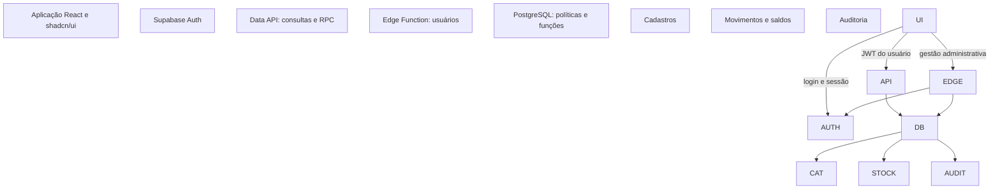
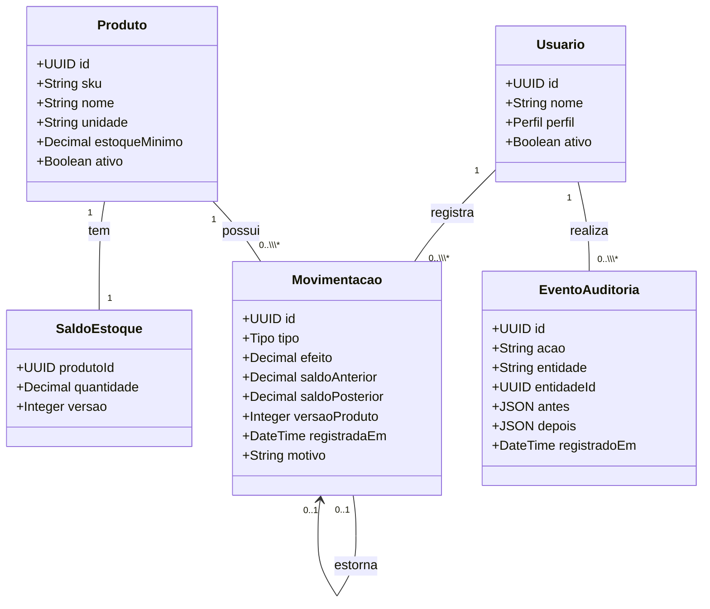
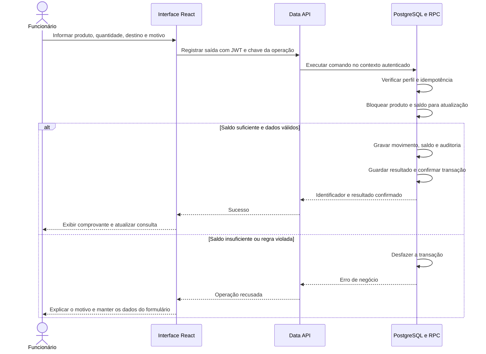

# Análise de Requisitos e Arquitetura de Software

# ALMOX: Sistema de Almoxarifado Corporativo 

**Disciplina:** Laboratório de Engenharia de Software - Trabalho 01    
**Apresentação:** 02/09/2026, duração de 5 a 10 minutos    
**Documento:** versão 0.1, elaborado em 01/09/2026    
**Situação:** proposta inicial para revisão do grupo; software ainda não implementado    
**Integrantes, professor e instituição:** preencher pelo grupo

### Síntese da proposta

Desenvolver uma aplicação web para cadastrar materiais, consultar quantidades disponíveis e registrar entradas e saídas de um almoxarifado corporativo. A solução utilizará React, TypeScript e shadcn/ui na interface, com Supabase para autenticação, banco PostgreSQL e execução das regras de negócio.

O requisito central é a rastreabilidade: cada alteração relevante deverá permitir identificar **quem realizou a ação, quando, sobre qual registro, com qual justificativa e qual foi o efeito no estoque**. Uma movimentação confirmada será preservada; sua correção gerará um novo lançamento vinculado ao original.

Esta versão considera uma organização, um almoxarifado e dois perfis: administrador e funcionário operador. Essas escolhas de escopo são premissas propostas, e não decisões já homologadas pelo solicitante. O prazo de 02/09 refere-se à apresentação da análise; não foi informado prazo para concluir o software.

### Correspondência com o enunciado

| Tópico exigido | Onde está desenvolvido |
| --- | --- |
| Identificação do problema | Seção 1 |
| Benchmark do mercado | Seção 3 |
| Requisitos funcionais | Seção 5 |
| Requisitos não funcionais | Seção 6 |
| Tecnologia a ser utilizada | Seção 8 |
| UML estático | Seção 9: diagrama de classes |
| UML dinâmico | Seção 10: diagrama de sequência |
| Arquitetura e planejamento complementares | Seções 8 e 11 a 15 |
| Organização da fala de 5 a 10 minutos | Seção 16 |

\<!-- pagebreak --\>

## 1\\. Identificação do problema

### 1.1 Contexto e hipótese de problema

Um almoxarifado precisa conhecer os materiais disponíveis e registrar seu recebimento e fornecimento aos setores da organização. Quando esse controle depende de registros dispersos, saldos alterados manualmente ou contas compartilhadas, torna-se difícil reconstruir o histórico e atribuir responsabilidade pelas operações.

As dores consideradas são divergência entre quantidade física e registrada, saídas sem identificação de destino, dificuldade para localizar materiais e demora na conferência de lançamentos. São hipóteses para orientar o projeto: ainda não houve observação de um almoxarifado real nem medição de perdas, tempo ou frequência dos problemas.

**Problema a resolver:** como centralizar o controle de materiais e suas movimentações, mantendo o saldo consistente e um histórico verificável por usuário?

### 1.2 Objetivo e resultados verificáveis

O objetivo é disponibilizar um controle de estoque simples, com acesso individual, permissões por perfil e histórico confiável. O MVP deverá demonstrar o cadastro de um produto, sua entrada, sua saída e uma correção rastreável.

O resultado será considerado adequado quando todas as movimentações confirmadas tiverem autoria e data, nenhuma operação permitida produzir saldo negativo, tentativas repetidas de uma mesma operação não duplicarem a baixa e um administrador conseguir reconstruir o saldo a partir do histórico. Os ganhos de produtividade dependerão de avaliação posterior com usuários.

### 1.3 Pessoas envolvidas

- **Administrador do almoxarifado:** mantém cadastros, acessos, ajustes e auditoria.
- **Funcionário operador:** registra recebimentos e entregas e consulta o estoque.
- **Setor destinatário e recebedor:** recebem os materiais; não precisam possuir conta no MVP.
- **Grupo desenvolvedor e professor:** implementam e avaliam a coerência entre problema, requisitos, arquitetura e demonstração.

## 2\\. Escopo e premissas

**Incluído no MVP:** autenticação; produtos, categorias e setores; consulta de saldo; entradas; saídas; ajuste por contagem; estorno integral; histórico; trilha de alterações cadastrais; alerta visual de estoque mínimo; gestão de usuários; exportação CSV administrativa.

**Recorte inicial:** uma organização e um almoxarifado, com endereço interno de prateleira ou posição como atributo do produto. Um lançamento movimenta um produto. Os itens são controlados por quantidade em uma unidade padrão, sem rastreamento individual de patrimônio.

**Evoluções fora do MVP:** múltiplos depósitos e transferências, compras e emissão fiscal, empréstimos de equipamentos, números de série, lotes e validade, leitura por câmera, anexos, aprovação de requisições, reservas, aplicativo nativo, operação offline e integração com ERP. Sua inclusão exige nova análise de dados e regras.

**Premissa de operação:** o funcionário é um operador autorizado do almoxarifado. Se o termo representar um colaborador que apenas solicita materiais, o modelo deverá incorporar requisições e aprovação antes da implementação das saídas.

\<!-- pagebreak --\>

## 3\\. Benchmark do mercado

### 3.1 Método

Comparação documental, consultada em 01/09/2026, com três produtos existentes. Foram observados controle de estoque, rastreabilidade, consulta gerencial e aderência ao uso interno. As fontes são páginas oficiais; não foram realizados testes práticos, cotação comercial ou avaliação de desempenho. A ausência de um recurso na página consultada não demonstra que o produto não o possui.

| Referência | Recursos observados nas fontes | Aprendizado para este projeto |
| --- | --- | --- |
| Odoo Inventory | Documenta entradas e saídas, lotes e números de série, reposição e trilha de ações relacionadas ao estoque. \\\[S1\] | Adotar rastreabilidade e estoque mínimo, mantendo o recorte de um almoxarifado. |
| Bling | Documenta lançamentos de entrada e saída e relatórios de movimentação, saldos e itens abaixo do estoque mínimo. \\\[S2, S3\] | Priorizar a consulta por produto e período e a visualização clara de saldos. |
| Snipe-IT | Documenta atribuição de ativos a pessoas e locais, histórico de entregas e devoluções e atividades recentes. \\\[S4\] | Distinguir material por quantidade de patrimônio individual e registrar o responsável pela operação. |

### 3.2 Posicionamento proposto

O projeto terá foco em abastecimento interno e rastreabilidade de materiais. O valor acadêmico está na implementação e demonstração das regras de domínio, da autorização e da consistência do estoque. Não se afirma que os concorrentes careçam dessas capacidades nem que desenvolver uma solução própria seja economicamente superior a contratá-los.

Para uma adoção real, a decisão entre construir e contratar exigirá avaliar custo total, suporte, adequação ao processo, migração e manutenção. Esses dados não foram fornecidos.

## 4\\. Perfis e permissões

| Ação | Administrador | Funcionário operador |
| --- | --- | --- |
| Consultar produtos, saldos e estoque mínimo | Sim | Sim |
| Consultar histórico operacional do almoxarifado | Sim | Sim |
| Registrar entrada e saída comuns | Sim | Sim |
| Cadastrar, editar e inativar produtos, categorias e setores | Sim | Não |
| Registrar ajuste de inventário ou estorno | Sim | Não |
| Consultar trilha de alterações cadastrais e de acessos | Sim | Não |
| Exportar relatórios CSV | Sim | Não |
| Convidar, ativar, desativar e alterar perfil de usuários | Sim | Não |
| Consultar dados completos dos demais usuários | Sim | Não |
| Editar ou excluir movimentação confirmada | Não | Não |
| Alterar saldo diretamente | Não | Não |

O histórico exibirá apenas a identificação operacional dos autores, sem e-mails. O administrador da aplicação continua sujeito às regras do sistema; seu perfil não concede os privilégios de administrador técnico do banco.

\<!-- pagebreak --\>

## 5\\. Requisitos funcionais

**Prioridades:** P0 = necessário para um controle seguro de estoque; P1 = complementar para concluir o MVP planejado. Os critérios abaixo descrevem verificações a implementar, não testes já executados.

### 5.1 Acesso e cadastros

| ID / prioridade | Requisito | Critério de aceitação |
| --- | --- | --- |
| RF01 / P0 | Autenticar usuários com e-mail e senha, permitir encerramento de sessão e recuperação de senha. | Credenciais válidas e perfil ativo permitem acesso. Sessão ausente ou expirada impede operações protegidas. |
| RF02 / P0 | Aplicar permissões de administrador e funcionário em toda operação protegida. | Funcionário não consegue ajustar estoque, alterar perfis ou consultar auditoria administrativa, inclusive por chamada direta à API. |
| RF03 / P0 | Cadastrar, consultar, editar e inativar produtos com SKU, nome, categoria, unidade, estoque mínimo e localização opcional. | SKU duplicado é rejeitado. Novo produto nasce com saldo zero. Alterações registram autor e valores anteriores e novos. |
| RF04 / P0 | Manter categorias e setores destinatários, preservando referências históricas. | Administrador pode cadastrar e alterar. Referências inativas não podem ser selecionadas em novas operações. |
| RF05 / P0 | Consultar produtos por nome, SKU, categoria e situação, com paginação. | A busca retorna os registros correspondentes e diferencia produto ativo, inativo e sem saldo. |
| RF06 / P0 | Consultar saldo atual e histórico de um produto. | A tela informa unidade, saldo, última atualização e lançamentos em ordem verificável por produto. |

O CRUD será aplicado aos cadastros com **exclusão lógica**, representada pela inativação. O histórico de movimentação terá operações de registrar, consultar e compensar. Essa distinção preserva o significado de auditabilidade sem apagar fatos anteriores.

### 5.2 Operações de estoque

| ID / prioridade | Requisito | Critério de aceitação |
| --- | --- | --- |
| RF07 / P0 | Registrar entrada com produto, quantidade, origem e motivo; referência documental opcional. | Entrada de 10 unidades em saldo 5 resulta em saldo 15 e um lançamento com autor, data e saldos anterior e posterior. |
| RF08 / P0 | Registrar saída com produto, quantidade, setor, identificação do recebedor e motivo. | Saída de 4 em saldo 10 resulta em 6. Saída de 11 é recusada e não modifica saldo ou histórico de movimentações confirmadas. |
| RF09 / P0 | Corrigir uma movimentação por estorno integral administrativo vinculado à original. | O estorno produz efeito inverso, exige motivo, preserva o original e não pode ser repetido para a mesma movimentação. |
| RF10 / P0 | Ajustar estoque a partir de contagem física administrativa. | Contagem 8 para saldo 10 gera ajuste de -2. Se a versão do estoque mudou desde a leitura usada na contagem, a operação é recusada para reconferência. |

\<!-- pagebreak --\>

### 5.3 Histórico, controle e gestão

| ID / prioridade | Requisito | Critério de aceitação |
| --- | --- | --- |
| RF11 / P0 | Consultar histórico por período, produto, tipo, autor e setor, incluindo vínculos de estorno. | Os filtros retornam somente os lançamentos correspondentes e permitem identificar o efeito de cada operação. |
| RF12 / P0 | Registrar e consultar auditoria de movimentações, cadastros e alterações de perfil ou situação de usuários. | Cada alteração concluída apresenta ação, entidade, autor, horário do servidor e conteúdo relevante anterior e posterior. |
| RF13 / P0 | Evitar duplicação de uma operação reenviada após duplo clique, timeout ou perda da resposta. | Mesma chave de operação e mesmo conteúdo retornam o resultado original sem nova movimentação. Conteúdo diferente com a mesma chave é rejeitado. |
| RF14 / P1 | Exibir painel com produtos ativos, itens zerados e itens no limite mínimo. | Indicadores correspondem aos saldos consultados; alerta é exibido quando saldo é menor ou igual ao mínimo configurado. |
| RF15 / P1 | Exportar saldo e movimentações filtradas em CSV para administradores. | Arquivo contém filtros e momento da geração, respeita permissões e representa uma consulta consistente. |
| RF16 / P0 | Gerenciar acesso de usuários por convite, perfil e situação, sem cadastro público livre. | Apenas administrador pode habilitar acesso. Usuário desativado é bloqueado na próxima requisição protegida após a desativação ser confirmada. |

### 5.4 Histórias de usuário

- **HU01 - Acesso:** como usuário autorizado, quero entrar com minha própria conta para que minhas ações sejam identificadas. Abrange RF01 e RF02.
- **HU02 - Catálogo:** como administrador, quero manter materiais, categorias e setores para padronizar os registros. Abrange RF03 e RF04.
- **HU03 - Consulta:** como operador, quero localizar um material e conhecer seu saldo para organizar o atendimento. Abrange RF05 e RF06.
- **HU04 - Recebimento:** como operador, quero registrar o que chegou e sua origem para atualizar o estoque. Abrange RF07 e RF13.
- **HU05 - Entrega:** como operador, quero registrar o que saiu e seu destino para evitar saídas sem identificação. Abrange RF08 e RF13.
- **HU06 - Correção:** como administrador, quero corrigir erros e divergências preservando sua explicação. Abrange RF09 e RF10.
- **HU07 - Conferência:** como administrador, quero examinar o histórico e suas alterações para verificar responsabilidades e reconstruir saldos. Abrange RF11 e RF12.
- **HU08 - Acompanhamento:** como administrador, quero visualizar níveis mínimos e exportar consultas para planejar reposição. Abrange RF14 e RF15.
- **HU09 - Acessos:** como administrador, quero conceder e encerrar acessos para manter a operação sob controle. Abrange RF16.

\<!-- pagebreak --\>

## 6\\. Requisitos não funcionais

As metas de desempenho e recuperação são propostas para homologação. Não representam capacidade já medida nem garantia contratual do Supabase ou da hospedagem.

| ID | Atributo | Requisito e forma de verificação |
| --- | --- | --- |
| RNF01 | Segurança | Todas as rotas de dados exigem identidade válida e perfil ativo. Testar matriz de permissões pela API, com usuário anônimo, funcionário, administrador e usuário desativado. |
| RNF02 | Integridade | Movimentação, saldo e auditoria são confirmados na mesma transação. Forçar falha intermediária e comprovar que nenhum efeito parcial permanece. |
| RNF03 | Concorrência | Duas saídas concorrentes não podem consumir a mesma quantidade disponível. Executar disputa pelo último saldo e verificar consistência do resultado e do histórico. |
| RNF04 | Rastreabilidade | 100% das alterações de negócio concluídas possuem autor, data do servidor e ação. Verificar amostras de todos os tipos de alteração e tentativas de adulteração pela API. |
| RNF05 | Desempenho | Meta de p95 até 2 s em consultas paginadas e até 3 s em movimentações, com 1.000 produtos, 10.000 movimentos e 10 usuários simultâneos. Medir no ambiente de homologação, com conexão estável e registrar também partidas a frio. |
| RNF06 | Usabilidade | Interface em português, confirmação antes de movimentar, mensagens de erro específicas e busca por nome ou SKU. Após uma orientação inicial, três participantes devem concluir uma entrada e uma saída sem auxílio. |
| RNF07 | Acessibilidade e compatibilidade | Operação por teclado, foco visível, rótulos nos campos, erros associados aos campos e contraste de texto normal de pelo menos 4,5:1. Verificar em larguras de 360 e 1366 px e versões estáveis de Chrome e Firefox. |
| RNF08 | Manutenibilidade | TypeScript com verificação estrita, módulos por domínio, migrações versionadas, instalação documentada e dados fictícios reproduzíveis. Um integrante deve conseguir preparar o ambiente seguindo o README. |
| RNF09 | Recuperação | Antes de uso real, validar cópia diária e restauração, com metas iniciais RPO de 24 h e RTO de 4 h. Confirmar o que o plano contratado cobre e testar recuperação de dados e acessos; exportar CSV não substitui backup. |
| RNF10 | Privacidade e observabilidade | Coletar apenas dados operacionais necessários; não registrar senhas, tokens ou chaves nos logs. Erros técnicos possuem identificador correlacionável, acesso restrito e prazo de retenção definido antes de produção. |

**Disponibilidade:** o protótipo dependerá da rede, do Supabase e da hospedagem do frontend. O MVP não terá operação offline nem compromisso de disponibilidade mensal. Uma meta corporativa dependerá do plano contratado, do orçamento e de suporte definido.

**Definições:** p95 é o tempo abaixo do qual ficam 95% das operações medidas; RPO é a perda máxima de dados tolerada em tempo; RTO é o tempo máximo proposto para recuperar o serviço.

\<!-- pagebreak --\>

## 7\\. Regras de negócio

### 7.1 Quantidade, unidade e saldo

- **RN01:** toda quantidade informada em entrada ou saída deve ser positiva. O banco determina o sinal do efeito conforme o tipo de operação.
- **RN02:** o saldo nunca pode ficar negativo, inclusive após estornos ou ajustes.
- **RN03:** cada produto possui uma única unidade de estoque. Unidades discretas, como UN e CX, aceitam somente inteiros; KG, L e M admitem até três casas decimais. Não haverá conversão entre caixa e unidade no MVP.
- **RN04:** quantidade e saldo usam decimal exato. Valores com precisão excedente devem ser rejeitados antes de qualquer arredondamento implícito.
- **RN05:** o produto nasce com saldo zero. A carga de uma quantidade preexistente usa lançamento de abertura, feito por administrador e permitido somente antes do primeiro movimento. Recebimentos novos usam entrada comum.
- **RN06:** o saldo é alterado exclusivamente por operações de domínio. O histórico de movimentos é a referência para reconstrução; o saldo armazenado é uma projeção atualizada na mesma transação.

**Equação de consistência:** saldo atual = soma dos efeitos de todas as movimentações do produto. Entradas e ajustes positivos somam; saídas e ajustes negativos subtraem; estornos possuem o efeito inverso do lançamento original.

### 7.2 Correções e contagem física

- **RN07:** movimentações confirmadas não podem ser editadas nem excluídas pelos perfis da aplicação. Corrigir quantidade, tipo ou destino requer estorno e, quando aplicável, novo lançamento correto.
- **RN08:** somente administrador realiza estorno, ajuste e abertura de estoque. Toda correção exige justificativa.
- **RN09:** o estorno é integral, referencia uma única movimentação original e ocorre no máximo uma vez para ela. Não haverá estorno de estorno. Os dois lançamentos permanecem visíveis e participam da soma do saldo.
- **RN10:** o estorno de uma entrada é recusado se sua reversão tornar o saldo negativo. O administrador deverá conferir a situação física e os movimentos envolvidos, sem ignorar a regra de saldo.
- **RN11:** o ajuste por contagem calcula a diferença entre quantidade física e saldo vigente. Exige a versão do estoque usada na conferência; uma movimentação interveniente invalida essa versão. A contagem igual ao saldo gera evento de conferência na auditoria, sem movimento de efeito zero.

**Exemplo didático:** entrada de 10, saída de 3 e estorno da saída de 3 produzem efeitos +10, -3 e +3, resultando em 10. Se a saída correta era 2, o novo lançamento de -2 deixa saldo 8 e preserva toda a explicação do erro.

### 7.3 Identificação e preservação

- **RN12:** toda saída exige setor e identificação operacional do recebedor. Toda entrada exige origem; documento de referência é opcional.
- **RN13:** autor e horário de registro são obtidos da sessão validada e do servidor. O cliente não escolhe autor nem retroage a data do lançamento.
- **RN14:** SKU normalizado é único, inclusive entre produtos inativos. A unidade não pode mudar depois do primeiro movimento. Categorias e setores referenciados não são apagados.
- **RN15:** produto só pode ser inativado com saldo zero. Produto inativo não aceita movimentações; um administrador deverá reativá-lo antes de uma operação legítima. A inativação de categoria com produtos ativos é recusada.
- **RN16:** o mesmo identificador de operação, para o mesmo usuário e conteúdo, não produz efeitos novamente. A chave é preservada durante a retenção do histórico correspondente.
- **RN17:** deve existir ao menos um administrador ativo. Operações concorrentes de remoção desse privilégio precisam preservar essa condição.

## 8\\. Tecnologia e arquitetura

### 8.1 Tecnologias propostas

| Camada | Tecnologia | Responsabilidade |
| --- | --- | --- |
| Interface | React + TypeScript + Vite | Páginas, componentes e build da aplicação web. |
| Componentes visuais | shadcn/ui + Tailwind CSS | Formulários, tabelas, diálogos e padrão visual. shadcn/ui distribui código de componentes adaptável ao projeto. \\\[S9\] |
| Navegação e dados | React Router + TanStack Query | Rotas protegidas na interface, cache de consultas e atualização após operações. |
| Formulários | React Hook Form + Zod | Feedback de validação no cliente; as regras são verificadas novamente no banco. |
| Identidade | Supabase Auth | Login, sessões, convite e recuperação de senha. |
| Persistência | Supabase PostgreSQL | Cadastros, restrições, transações, saldos, movimentos e auditoria. |
| Acesso a dados | Supabase JS + Data API | Consultas autorizadas e chamadas RPC de comandos de negócio. |
| Regras críticas | Funções PostgreSQL + triggers + RLS | Autorização, movimentação atômica, concorrência e trilha de auditoria. \\\[S5, S6\] |
| Administração de identidade | Supabase Edge Function | Validar administrador e executar operações privilegiadas de convite na API administrativa de Auth. |
| Qualidade e entrega | Git, migrações Supabase, Vitest, Playwright e testes SQL | Versionamento, verificação de regras e testes de jornadas críticas. |

As versões serão fixadas no início do desenvolvimento em arquivos de dependências. O frontend pode ser hospedado em um serviço de arquivos estáticos com HTTPS e redirecionamento para a SPA. O provedor ainda será escolhido pelo grupo.

### 8.2 Organização arquitetural

A proposta utiliza uma aplicação web modular apoiada por serviços gerenciados do Supabase. Os módulos de interface serão Acesso, Catálogo, Estoque, Auditoria e Administração. Cada módulo expõe suas operações por uma camada de serviços, evitando espalhar chamadas ao banco pelos componentes.

O frontend apresenta dados e interações. O banco concentra as invariantes que precisam valer para qualquer cliente. Consultas passam por políticas de acesso; comandos de escrita passam por funções de negócio. Não é necessário um servidor Express separado para este recorte.

\<!-- diagram:architecture --\>

**Figura 1 - Visão de componentes.** Cadastros, movimentos, saldos e auditoria são estruturas do mesmo banco; não representam bancos ou serviços separados. A Edge Function é reservada para operações de identidade que exigem credencial privilegiada.

### 8.3 Decisões arquiteturais duráveis

- **DA01:** um único domínio organizacional e um almoxarifado no MVP; expansão para várias organizações exigirá isolamento explícito em todas as entidades e políticas.
- **DA02:** leituras autorizadas pela Data API; escritas por comandos de domínio com validação no servidor.
- **DA03:** histórico de movimentos preservado e saldo materializado, com atualização transacional e reconciliação pela soma dos efeitos.
- **DA04:** autenticação Supabase e autorização baseada em perfil ativo controlado pelo sistema.
- **DA05:** responsabilidades separadas por módulos de negócio; uma única base relacional para consistência transacional.
- **DA06:** auditoria gerada no banco para alterações de negócio, sem depender de uma segunda chamada do navegador.

\<!-- pagebreak --\>

## 9\\. UML estático: diagrama de classes

O diagrama representa o núcleo conceitual. Categorias, setores e estruturas técnicas de idempotência aparecem no modelo de dados da seção 11. As classes representam conceitos do domínio, sem exigir uma implementação orientada a objetos no PostgreSQL.

\<!-- diagram:classes --\>

**Figura 2 - Diagrama de classes UML.** Um produto possui exatamente um saldo e pode ter várias movimentações. Cada movimentação tem um autor. O vínculo de estorno é opcional e limitado a um para um: uma original pode receber no máximo um estorno e um estorno referencia exatamente uma original.

A entidade auditada é indicada pelo par entidade e entidadeId. Um evento pode registrar alteração de produto, usuário, setor ou movimentação; por isso não foi desenhada uma associação exclusiva entre auditoria e movimento. Atividades técnicas de infraestrutura ficam em logs próprios, separados das ações de usuários do domínio.

\<!-- pagebreak --\>

## 10\\. UML dinâmico: registrar saída de material

**Caso de uso UC01.** Ator principal: funcionário operador ou administrador. Pré-condições: sessão válida, usuário ativo, produto ativo e setor ativo. Resultado esperado: saída confirmada, saldo atualizado e auditoria registrada de forma indivisível.

\<!-- diagram:sequence --\>

**Figura 3 - Diagrama de sequência UML.** A confirmação no banco é anterior à mensagem de sucesso. O saldo exibido no navegador não é usado como autoridade para permitir a saída.

**Fluxos alternativos adicionais:** sessão inválida interrompe o acesso; usuário desativado ou sem permissão recebe recusa; chave já concluída retorna o resultado armazenado, sem executar nova baixa; mesma chave com conteúdo diferente gera conflito. Falta de conexão após enviar a operação deixa o resultado desconhecido até consulta ou reenvio com a mesma chave.

**Concorrência ilustrada:** com saldo 5 e duas saídas simultâneas de 4, uma operação conclui e deixa saldo 1; a outra, ao obter o bloqueio, verifica o saldo atualizado e é recusada. Bloqueios de linha do PostgreSQL fundamentam essa serialização por produto. \\\[S8\]

\<!-- pagebreak --\>

## 11\\. Modelo de dados e invariantes

### 11.1 Entidades propostas

Os nomes abaixo são uma proposta de esquema, sujeita a ajuste no início do desenvolvimento. UUID identifica entidades; quantidades usam NUMERIC(14,3); horários usam TIMESTAMPTZ, apresentados no fuso configurado da organização.

| Entidade | Campos principais | Restrições relevantes |
| --- | --- | --- |
| profiles | id, display\\\_name, role, active, created\\\_at | id referencia auth.users; role restrito a admin ou employee; alteração de privilégio somente administrativa. |
| categories | id, name, active | Nome normalizado único; referências preservadas. |
| departments | id, name, active | Identifica setor destinatário; não representa outro almoxarifado. |
| products | id, sku, name, description, category\\\_id, unit, minimum\\\_stock, location, active | SKU único normalizado; mínimo não negativo; unidade protegida após primeiro movimento. |
| stock\\\_balances | product\\\_id, quantity, version, updated\\\_at | product\\\_id é PK e FK; saldo não negativo; registro criado junto com o produto. |
| stock\\\_movements | id, product\\\_id, actor\\\_id, kind, delta, balance\\\_before, balance\\\_after, product\\\_version, reason, origin, department\\\_id, recipient\\\_ref, document\\\_ref, reversal\\\_of, recorded\\\_at, snapshots | Efeito diferente de zero; saldo posterior = anterior + efeito; saldo posterior não negativo; versão única por produto; estorno único por original. |
| stock\\\_commands | actor\\\_id, operation\\\_key, request\\\_hash, result, completed\\\_at | Chave composta única; conteúdo canonizado para comparação; resultado e efeitos persistidos na mesma transação. |
| access\\\_requests | id, actor\\\_id, operation\\\_key, target\\\_email, auth\\\_user\\\_id, status, created\\\_at | Registra pedido de convite e seu resultado; chave única por administrador; estados pendente, concluído ou falha. |
| audit\\\_events | id, actor\\\_id, action, entity\\\_type, entity\\\_id, before\\\_data, after\\\_data, operation\\\_key, recorded\\\_at | Inserção controlada pelo banco; atualização e exclusão bloqueadas para perfis da aplicação. |

O esquema de autenticação mantém credenciais; senhas não serão duplicadas em profiles. O perfil associado ao histórico não será apagado por exclusão em cascata de uma conta. Desativação é a operação padrão; eventual anonimização precisará de procedimento específico compatível com retenção e responsabilidade.

Os tipos de movimentação são ENTRADA, SAIDA, ABERTURA, AJUSTE e ESTORNO. ABERTURA, AJUSTE e ESTORNO são administrativos. Restrições e funções validam o sinal e os campos exigidos de cada tipo.

### 11.2 Preservação do significado histórico

Cada movimento preservará os identificadores e uma cópia dos rótulos relevantes no momento da operação: SKU, nome, unidade, identificação operacional do autor e nome do setor. Assim, renomear um cadastro não reescreve a apresentação do fato passado.

A versão de estoque cresce a cada alteração de quantidade e estabelece a ordem por produto. Horários não serão usados isoladamente para determinar essa ordem. O relógio do servidor registra a operação; não haverá lançamentos retroativos no MVP.

### 11.3 Índices e exclusões

Prever índices para SKU, produto e versão, data do movimento, autor, setor e tipo de evento. A busca textual será dimensionada com dados de homologação; um índice textual específico só será acrescentado quando necessário.

Chaves estrangeiras preservam referências. Não haverá exclusão em cascata de produtos, usuários ou movimentos históricos. Categorias, setores e produtos serão inativados conforme as regras da seção 7.

## 12\\. Operações, segurança e auditoria

### 12.1 Contratos de serviço

| Operação proposta | Entrada do cliente | Resultado esperado |
| --- | --- | --- |
| Registrar entrada ou saída | Produto, quantidade decimal em texto, tipo permitido, origem ou destino, motivo e chave da operação | ID do movimento, saldo e versão resultantes naquela confirmação. |
| Estornar movimentação | ID original, motivo e chave da operação | Novo movimento de efeito inverso e vínculo com o original. |
| Ajustar por contagem | Produto, quantidade física, versão observada, motivo e chave da operação | Ajuste da diferença ou evento de contagem sem divergência. |
| Manter cadastros | Identificador quando existente e campos permitidos | Cadastro atualizado com auditoria correspondente. |
| Administrar usuários | Usuário alvo, ação permitida e dados mínimos | Alteração autorizada; convite com estado consultável e possibilidade de repetição segura. |

As respostas distinguem falta de autenticação, falta de permissão, dados inválidos, saldo insuficiente, conflito de versão e chave reutilizada com outro conteúdo. O frontend traduzirá os códigos em mensagens claras; detalhes SQL não serão expostos ao usuário.

### 12.2 Transação de movimentação

1. Obter o autor da sessão e verificar perfil ativo e permissão para o comando.
2. Registrar a chave de operação sob unicidade no banco. Se já houver resultado confirmado, comparar o conteúdo e retorná-lo. Requisições concorrentes com a mesma chave devem aguardar a resolução da primeira.
3. Validar os dados e bloquear os registros do produto e do saldo, sempre na mesma ordem. Reavaliar situação do produto, saldo e versão dentro da transação.
4. Calcular o efeito e impedir saldo negativo. No ajuste, comparar a versão observada; no estorno, verificar original, efeito inverso e ausência de estorno anterior.
5. Inserir o movimento, atualizar saldo e versão e gerar auditoria por mecanismo do banco. Contagem sem diferença gera somente evento de conferência.
6. Gravar a resposta associada à chave e confirmar tudo junto. Qualquer erro anterior à confirmação desfaz também o registro da chave.

Para um reenvio concluído, o saldo retornado é o resultado daquela operação, não uma garantia de saldo atual. A interface deverá consultar o saldo novamente. Uma chave não substitui o controle de concorrência entre operações diferentes.

### 12.3 Autorização efetiva

RLS controla acesso às linhas; permissões de tabelas e de execução de funções complementam essa proteção. O projeto negará escrita direta de clientes nas tabelas de domínio. Funções de comando poderão usar SECURITY DEFINER quando necessário, com proprietário de privilégios mínimos, search\\\_path fixo, nomes qualificados e validação explícita do usuário e do perfil. Apenas funções autorizadas receberão EXECUTE para usuários autenticados. \\\[S5, S6\]

Views expostas deverão respeitar as políticas das tabelas, por exemplo com security\\\_invoker quando suportado. A consulta de perfil usada pelas políticas precisa evitar recursão. O papel administrativo não será aceito de parâmetros do navegador nem de metadados editáveis pelo usuário. \\\[S5\]

O frontend terá URL do projeto e chave publicável, acompanhada do JWT do usuário. A credencial secreta ou service\\\_role será restrita ao ambiente de servidor, pois possui acesso elevado e pode ultrapassar RLS. A Edge Function verificará a identidade e o privilégio antes de usar a API administrativa. \\\[S7\]

A credencial privilegiada atenderá às operações de Auth. Alterações de dados de negócio iniciadas pela Edge Function usarão o contexto autenticado do administrador nas funções do banco, preservando autoria sem aceitar um actor\\\_id arbitrário. Um perfil criado por convite nasce sem acesso ativo até a habilitação administrativa.

O primeiro administrador será criado por procedimento técnico documentado. Alterações que possam remover o último administrador ativo serão serializadas. Operações de convite envolvem Auth e aplicação: deverão ter estado de execução, reconciliação de falhas e acesso negado enquanto o perfil não estiver habilitado; não se presume uma transação única envolvendo envio de e-mail.

### 12.4 O que a auditoria garante

A trilha preserva ações concluídas pelos caminhos controlados da aplicação e permite verificar sua autoria e efeitos. Triggers registram alterações cadastrais e inserções de movimentos; a falha ao registrar auditoria deve impedir a operação de negócio correspondente.

Uma tentativa recusada não é uma movimentação concluída. Logs de falhas, quando necessários, são registrados fora da transação revertida, por mecanismo de observabilidade com acesso restrito. Eles não alteram o saldo.

A proteção não torna o banco inviolável contra seu proprietário técnico. Auditoria resistente a administradores de infraestrutura exigiria cópias externas, armazenamento com retenção protegida e procedimentos adicionais. Esse nível de evidência não integra o MVP.

\<!-- pagebreak --\>

## 13\\. Interface e jornadas

### 13.1 Rotas e páginas

| Rota proposta | Conteúdo | Público |
| --- | --- | --- |
| /login e /recuperar-senha | Acesso e recuperação | Usuário sem sessão |
| /painel | Indicadores e estoque mínimo | Ambos os perfis |
| /produtos e /produtos/:id | Catálogo, saldo e histórico do item | Ambos; manutenção administrativa |
| /movimentacoes | Histórico e filtros | Ambos os perfis |
| /movimentacoes/nova | Formulário de entrada ou saída | Ambos os perfis |
| /inventario | Conferência física e ajustes | Administrador |
| /auditoria | Alterações de cadastros e acessos | Administrador |
| /administracao | Usuários, categorias e setores | Administrador |

Os bloqueios de rota organizam a navegação; a autorização continuará sendo verificada no servidor. Tabelas terão busca, paginação e estados de carregamento, vazio e erro. Quantidades mostrarão sua unidade, e ações administrativas serão identificadas com clareza.

### 13.2 Jornada principal

O operador entra no sistema, localiza um produto, confere a unidade e abre uma entrada ou saída. Preenche os dados e revisa um resumo antes de confirmar. Durante o envio, a interface evita novos cliques e preserva a chave da operação. Depois da confirmação do servidor, exibe o identificador do lançamento e atualiza as consultas.

Se a resposta se perder, a interface informa que a confirmação ainda está sendo verificada e reutiliza a mesma chave. Não deverá simplesmente criar outro lançamento. Erros de validação preservam os campos preenchidos para correção.

## 14\\. Verificação e rastreabilidade

### 14.1 Cenários de aceitação prioritários

| Teste planejado | Resultado verificável | Requisitos |
| --- | --- | --- |
| TA01: entrada 10 e saída 3 | Saldo 7; dois movimentos com autores e horários. | RF07, RF08, RF12 |
| TA02: saldo 5, duas saídas simultâneas de 4 | Uma conclui; outra é recusada; saldo 1. | RNF02, RNF03 |
| TA03: reenviar o mesmo comando | Mesmo resultado, um único movimento e uma única baixa. | RF13, RN16 |
| TA04: reutilizar chave com outro conteúdo | Conflito explícito, sem novos efeitos. | RF13 |
| TA05: estornar saída e tentar estornar novamente | Primeira correção vinculada; segunda recusada. | RF09, RN09 |
| TA06: estornar entrada já consumida | Recusa se o saldo ficaria negativo. | RN02, RN10 |
| TA07: funcionário chama ajuste ou muda seu perfil pela API | Acesso negado; nenhum dado modificado. | RF02, RF16 |
| TA08: falha ao gravar auditoria | Movimento e saldo não permanecem gravados. | RF12, RNF02 |
| TA09: ajustar usando versão anterior do estoque | Conflito; exige nova conferência. | RF10, RN11 |
| TA10: desativar usuário com sessão existente | Próxima requisição protegida após confirmação é negada. | RF16, RNF01 |
| TA11: renomear produto e consultar operação antiga | Rótulos históricos e trilha de alteração preservados. | RF03, RF12 |
| TA12: alterar ou apagar movimento por API direta | Operação negada para ambos os perfis. | RN07, RNF04 |

Os testes de invariantes serão executados contra PostgreSQL/Supabase de teste, incluindo concorrência real. Testes de interface cobrirão as jornadas essenciais. Mocks de frontend não comprovam RLS nem atomicidade.

**Definição de pronto:** critérios da entrega atendidos; revisão por outro integrante; migrações reproduzíveis; testes críticos aprovados; documentação atualizada; demonstração com dados fictícios; nenhuma chave secreta no cliente ou no repositório. Os testes desta seção estão planejados e ainda não foram executados contra um sistema implementado.

\<!-- pagebreak --\>

## 15\\. Plano de desenvolvimento e decisões pendentes

### 15.1 Organização por entregas completas

Fonte do plano: requisitos e decisões DA01 a DA06 deste documento. Cada entrega combina interface, autorização, persistência e verificação necessárias para demonstrar um comportamento utilizável. As dependências abaixo são propostas para revisão pelo grupo. \\\[M2\]

| Entrega | Comportamento demonstrável | Histórias | Depende de |
| --- | --- | --- | --- |
| E1 - Acesso e consulta inicial | Dois usuários de teste entram e veem catálogo fictício somente com perfil ativo. Políticas mínimas são verificadas pela API. | HU01, HU03 | Nenhuma |
| E2 - Manutenção do catálogo | Administrador cria produto com saldo zero, categoria e setor; funcionário consulta e tem edição recusada. Alterações já geram auditoria. | HU02, HU03, HU07 | E1 |
| E3 - Recebimento rastreável | Operador registra entrada, vê saldo e histórico; reenvio da mesma operação não duplica o recebimento. | HU04, HU07 | E2 |
| E4 - Entrega consistente | Operador registra saída com destino; quantidade insuficiente e concorrência são tratadas. | HU05, HU07 | E3 |
| E5 - Conferência e correções | Administrador registra ajuste e estorno; conta física desatualizada e estorno repetido são recusados. | HU06 | E4 |
| E6 - Gestão de acessos | Administrador convida e desativa usuários e consulta as alterações; último administrador permanece protegido. | HU09, HU07 | E2 |
| E7 - Acompanhamento e homologação | Painel, filtros e CSV funcionam; grupo executa jornadas, recuperação e revisão de permissões. | HU08, HU07 | E5 e E6 |

**Critérios de conclusão por entrega:** E1 bloqueia acesso anônimo e inativo; E2 audita cadastro e impede edição por funcionário; E3 passa TA01 para entrada, TA03 e TA04; E4 passa TA01 completo e TA02; E5 passa TA05, TA06 e TA09; E6 passa TA07 e TA10 e o caso de último administrador; E7 passa a suíte integrada, TA08, TA11, TA12 e verifica exportações.

### 15.2 Marcos e responsabilidades

**Até 02/09/2026:** revisar este documento, preencher identificação do grupo, selecionar os pontos da fala e ensaiar os diagramas. Essa é a entrega de análise especificada pelo enunciado.

**Após a apresentação:** confirmar escopo com professor e grupo, definir disponibilidade e prazo de implementação e distribuir E1 a E7. Uma cadência semanal de demonstração é proposta; não há estimativa de calendário fechada sem conhecer a equipe.

O grupo deverá atribuir responsáveis por requisitos, interface, dados e segurança, testes e apresentação. Uma pessoa pode acumular funções, mas cada entrega deve ter um responsável identificável e outro integrante para revisão. O histórico do projeto ficará em repositório Git com decisões e migrações versionadas.

### 15.3 Perguntas críticas para validação

O método Grill Me orienta questionar as decisões e suas dependências. As escolhas abaixo permanecem propostas e devem ser validadas com o grupo e o responsável pelo processo. A entrevista de requisitos não é considerada concluída. \\\[M1\]

| Questão de negócio | Recomendação para esta versão | Impacto se a resposta mudar |
| --- | --- | --- |
| Funcionário opera estoque ou apenas solicita materiais? | Operador autorizado registra entrada e saída. | Solicitações exigem requisição, estados, aprovação e confirmação de entrega. |
| Há um almoxarifado ou vários? | Um almoxarifado. | Vários exigem saldo por local, transferências e permissões por depósito. |
| São materiais por quantidade ou bens individuais emprestados? | Materiais por quantidade. | Patrimônio exige identificação individual, custódia e devolução. |
| Quais unidades e precisões são usadas? | UN e CX inteiras; KG, L e M até três casas. | Conversões e unidades adicionais alteram validação e relatórios. |
| Que evidência deve acompanhar entradas e saídas? | Origem ou destino, recebedor, motivo e referência opcional. | Comprovantes obrigatórios exigem anexos, retenção e controle de acesso. |
| Qual é o prazo de retenção e quem audita? | Preservar o histórico do projeto; administrador consulta. | Uso real exige política definida e pode exigir auditor independente. |
| Qual é a equipe, o orçamento e a data de entrega do software? | Definir após a análise. | Determina calendário, hospedagem, suporte e corte de funcionalidades P1. |

### 15.4 Riscos e respostas propostas

- **Crescimento do escopo:** manter o recorte registrado; aprovações, patrimônio e múltiplos locais geram nova versão dos requisitos.
- **Saldo incorreto por concorrência:** transação, bloqueio por produto, invariantes e testes simultâneos.
- **Autorização apenas visual:** verificar permissões pela API desde E1 e negar escrita direta.
- **Auditoria incompleta:** gerar registros no banco, preservar movimentos e tratar falha de auditoria como falha da operação.
- **Demonstração sem rede:** levar os diagramas e uma sequência ilustrada com dados fictícios; preparar ambiente local de desenvolvimento se a equipe conseguir mantê-lo.
- **Contagem física durante movimentação:** comparar versão e orientar reconferência; o processo operacional também precisa organizar a contagem.

\<!-- pagebreak --\>

## 16\\. Roteiro para a apresentação

### 16.1 Distribuição sugerida: oito minutos

| Tempo | Tópico | Mensagem principal |
| --- | --- | --- |
| 0:00 a 0:50 | Problema e objetivo | Precisamos conhecer o saldo e reconstruir quem recebeu ou entregou cada material. |
| 0:50 a 1:40 | Benchmark | Odoo, Bling e Snipe-IT oferecem referências de estoque, relatórios e rastreabilidade; nosso recorte é o almoxarifado interno. |
| 1:40 a 3:00 | Requisitos funcionais e perfis | Mostrar catálogo, entrada, saída, consulta e correção; explicar o que só o administrador pode fazer. |
| 3:00 a 3:50 | Requisitos não funcionais | Destacar autorização, atomicidade, concorrência, rastreabilidade e usabilidade. |
| 3:50 a 4:50 | Tecnologias e arquitetura | React e shadcn/ui na interface; Supabase Auth e PostgreSQL para dados e regras. |
| 4:50 a 5:50 | UML estático | Explicar Produto, Saldo, Movimentação, Usuário e Evento de Auditoria. |
| 5:50 a 7:10 | UML dinâmico | Percorrer a saída, a validação do saldo e a confirmação conjunta; mostrar o caminho de recusa. |
| 7:10 a 8:00 | Escopo e próximos passos | Apresentar as entregas e o que será validado antes da implementação. |

### 16.2 Exemplo que conecta requisitos e arquitetura

Usar o mesmo produto fictício em toda a apresentação: uma caixa de luvas, controlada em CX. Registrar entrada de 10 caixas, saída de 3 para um setor e tentativa de saída de 8. O saldo permanece 7 após a recusa. Em seguida, explicar que um erro na saída é corrigido por estorno administrativo, preservando o histórico.

Esse exemplo evidencia o saldo, o destino, a autoria, a diferença entre administrador e funcionário e a necessidade de validar a operação no banco. Não apresentar o exemplo como demonstração de software já implementado.

### 16.3 Se o professor perguntar

**Por que não apenas uma planilha?** O projeto pretende aplicar identidade individual, permissões e regras transacionais verificáveis, além de organizar o histórico. A comparação de custo e adoção real ainda precisaria ser feita.

**Por que o administrador não pode apagar uma saída?** Apagar eliminaria parte da explicação do saldo. O estorno corrige o efeito e mantém a referência do que aconteceu.

**Por que usar Supabase?** A escolha já faz parte da ideia proposta e reúne autenticação e PostgreSQL. A equipe ainda precisa implementar corretamente políticas, funções e regras de negócio.

**Como evitar duas pessoas retirarem o último item?** Ambas disputam a mesma linha de saldo; a segunda operação só decide após ler o resultado confirmado pela primeira.

**Esse sistema já está pronto?** Não. Esta entrega é a análise de requisitos e a proposta de arquitetura; o desenvolvimento seguirá as entregas planejadas.

\<!-- pagebreak --\>

## 17\\. Referências

Fontes consultadas em 01/09/2026. As referências de mercado descrevem recursos documentados pelos fornecedores; as decisões de escopo e arquitetura são propostas do projeto.

- **\\\[S1\] Odoo.** Inventory: Features. Rastreabilidade, operações e auditoria. <https://www.odoo.com/app/inventory-features> 
- **\\\[S2\] Bling.** Relatórios do Bling. <https://ajuda.bling.com.br/hc/pt-br/articles/10448301650455-Relat%C3%B3rios-do-Bling> 
- **\\\[S3\] Bling.** Como inserir estoque no produto do Bling. <https://ajuda.bling.com.br/hc/pt-br/articles/360035628694-Como-inserir-estoque-no-produto-do-Bling> 
- **\\\[S4\] Snipe-IT.** Product Features. <https://snipeitapp.com/product> 
- **\\\[S5\] Supabase.** Row Level Security. <https://supabase.com/docs/guides/database/postgres/row-level-security> 
- **\\\[S6\] Supabase.** Database Functions. <https://supabase.com/docs/guides/database/functions> 
- **\\\[S7\] Supabase.** API keys. <https://supabase.com/docs/guides/getting-started/api-keys> 
- **\\\[S8\] PostgreSQL.** Explicit Locking. <https://www.postgresql.org/docs/current/explicit-locking.html> 
- **\\\[S9\] shadcn/ui.** Introduction. <https://ui.shadcn.com/docs> 
- **\\\[M1\] Matt Pocock.** Grill Me / Grilling. Instruções públicas de entrevista e exploração de decisões. <https://github.com/mattpocock/skills/blob/main/skills/productivity/grilling/SKILL.md> 
- **\\\[M2\] Matt Pocock.** PRD to Plan. Instruções consultadas em cópia pública do arquivo, no commit de 21/03/2026. <https://src.liamrohan.com/ldr/skills/commit/bca0ac3e4d2f393d8d060221b80a860cc88f9071>

### Nota sobre o processo de elaboração

Foram consultadas instruções públicas de Grill Me e PRD to Plan para orientar o levantamento de questões, o registro de decisões e o planejamento de entregas completas. O documento identifica as premissas que precisam de validação e permanece em versão 0.1. A estrutura atende ao enunciado fornecido, sem representar homologação por usuários reais ou resultado de testes de uma implementação.

### Glossário de apoio

**CRUD:** criar, consultar, atualizar e excluir; neste projeto a exclusão cadastral é lógica. **SKU:** código único de um produto. **MVP:** primeira versão utilizável com o escopo essencial. **RLS:** políticas que controlam quais linhas um usuário pode acessar. **RPC:** chamada remota de uma função. **JWT:** token usado para representar uma sessão autenticada. **Atomicidade:** uma transação conclui integralmente ou não deixa efeitos parciais. **Idempotência:** repetir o mesmo comando identificado não repete seus efeitos. **Estorno:** lançamento que compensa outro. **Auditoria:** registro verificável de ações, autoria e alterações.
